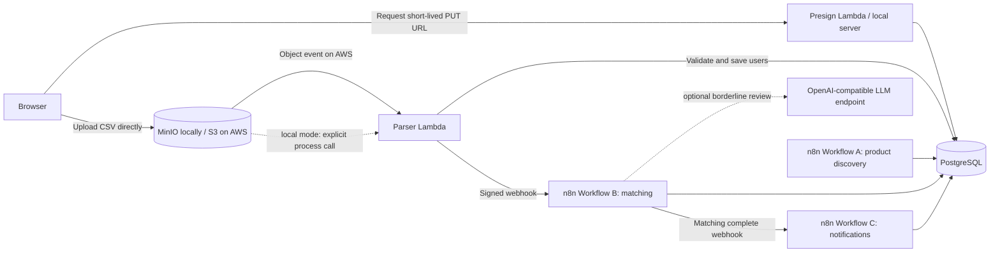

# Loan Eligibility Engine

An event-driven prototype that imports a CSV of applicant profiles, checks those profiles against loan-product criteria, and records potential matches. The project demonstrates direct-to-object-storage uploads, streaming validation, SQL-based filtering, workflow orchestration, and an optional LLM review stage for borderline cases.

> **Prototype notice:** This repository is a demonstration, not a lending or credit decision system. Product data includes fictional seed records and local mock lender pages. Do not upload real personal or financial data. The local UI and API are unauthenticated, and the included sample CSV contains personal and financial fields. Keep sample data private when publishing or deploying this repository.

## How it works



The browser requests a presigned URL and uploads the CSV straight to MinIO or S3. The parser streams and validates rows in chunks, stores valid profiles in PostgreSQL, and notifies n8n. Workflow A discovers products from two deterministic local mock pages; seed products provide a fallback. Workflow B applies SQL eligibility criteria, then additional affordability rules, and can send a bounded set of borderline cases to a configured LLM. Workflow C is configured to route notifications to test inboxes rather than applicant addresses.

## Components

- **Python handlers:** presigned upload URL and CSV parsing under `lambdas/`.
- **PostgreSQL:** upload batches, user profiles, products, matches, LLM cache, and pipeline metrics; schema and seed data are in `db/`.
- **n8n:** product discovery, matching, and notification workflows in `n8n/workflows/`.
- **MinIO:** local S3-compatible object storage.
- **Browser UI:** minimal upload page in `ui/index.html`.
- **Optional AWS packaging:** Serverless Framework configuration for two Python 3.11 Lambdas, an HTTP API, and an S3 bucket. The stack does not create PostgreSQL/RDS or deploy n8n.

## Requirements

- Docker Desktop with Docker Compose
- Python 3.11 or later
- Node.js and npm (only for Serverless packaging/deployment)
- An OpenAI-compatible LLM API key only if enabling the optional LLM stage
- AWS CLI credentials only if deploying to AWS

## Run locally

1. Clone the repository and enter its directory.
2. Create a local environment file and set unique local secrets:

   ```powershell
   Copy-Item .env.example .env
   ```

   At minimum, change the database password, MinIO password, n8n encryption key, and webhook secret. Keep `.env` private; it is ignored by Git. The LLM settings may remain empty to skip external LLM review.

3. Start PostgreSQL, n8n, and MinIO:

   ```powershell
   docker compose up -d
   ```

   Postgres initializes `db/schema.sql` and `db/seed_products.sql` the first time its data volume is created. Open n8n at `http://localhost:5678` and finish its initial setup.

4. Import the three workflow JSON files from `n8n/workflows/` into n8n. Configure the Postgres credentials for the Postgres nodes; configure AWS credentials for the SES node in Workflow C if using it. Activate Workflows B and C for webhook-triggered runs. Set required n8n environment values in `.env` before starting the containers; after changing them, recreate n8n with `docker compose up -d n8n`.

5. For the product crawler demo, serve the local mock pages from the `data/mock_sites` directory:

   ```powershell
   Set-Location data/mock_sites
   python -m http.server 8080
   ```

   Configure Workflow A to fetch the mock pages at `http://host.docker.internal:8080/` and run it from n8n. It upserts discovered products, so repeat runs do not create duplicate provider/product rows.

6. In a second terminal at the repository root, start the local upload server:

   ```powershell
   .venv\Scripts\python.exe scripts\local_server.py
   ```

   If the virtual environment has not been created, create it and install dependencies first:

   ```powershell
   py -3.11 -m venv .venv
   .venv\Scripts\python.exe -m pip install -r requirements.txt
   ```

7. Open `http://localhost:8000`, select a CSV with the required columns, and upload. The local server calls the parser after the MinIO upload because MinIO does not invoke a Lambda event. On AWS, the S3 object event invokes the parser instead.

The expected CSV columns are `user_id,name,email,monthly_income,credit_score,employment_status,age`. The parser validates records, skips invalid rows, and processes the file in chunks of up to 1,000. The local upload service binds to `127.0.0.1`; keep it on a trusted machine.

### Local service addresses

| Service | Address |
| --- | --- |
| Upload page and local API | `http://localhost:8000` |
| n8n | `http://localhost:5678` |
| MinIO API / console | `http://localhost:9000` / `http://localhost:9001` |
| PostgreSQL | `localhost:5432` |

## Matching funnel

The recorded local run processed 10,000 sample users against 30 products (18 seed products and 12 from mock pages). These are historical demo measurements, not a performance guarantee:

| Stage | Pairs | Share of starting pairs |
| --- | ---: | ---: |
| All user × product pairs | 300,000 | 100.00% |
| After SQL pre-filter | 105,339 | 35.11% |
| After EMI and rate rules | 104,294 | 34.76% |
| Final recorded matches | 104,294 | 34.76% |

SQL eligibility checks removed 194,661 pairs (64.89%); the deterministic EMI and rate rules removed a further 1,045. The run identified 40,986 borderline pairs, but recorded **zero completed LLM calls**. Those borderline pairs remained matched; hidden criteria were not resolved. A hypothetical request size of 20 pairs would take 15,000 requests to review all 300,000 pairs, but this run does not demonstrate LLM cost savings or eligibility decisions. See [`docs/treasure_hunt.md`](docs/treasure_hunt.md) for methodology and run caveats.

## Email safety and status

Workflow C is designed to send to `TEST_EMAIL_1` and `TEST_EMAIL_2`, never to addresses from the uploaded CSV, and to cap a batch at `MAX_DEMO_EMAILS` (default 5). The recorded test run routed five items to its email-failure path; successful delivery was not verified. Do not treat notification delivery as a completed feature.

The project notes also say that repeat-upload/replay and malformed-header cases, the browser upload acceptance check, and several workflow acceptance checks have not all been verified. AWS packaging succeeded with temporary placeholder values, but no AWS deployment was performed. Review `memory.md` for the current development status before relying on any behavior.

## Optional AWS packaging and deployment

The Serverless stack provisions two Lambdas, an HTTP API for `GET /presign`, and an S3 bucket configured to invoke the parser on uploads. It expects an independently managed PostgreSQL database and n8n endpoint. See `.env.example` and the AWS section of this README for the deployment variables; use AWS-specific values and a globally unique bucket name. Restrict the UI CORS origin to the exact HTTPS origin before deployment, and store production credentials in AWS Systems Manager Parameter Store or Secrets Manager.

```powershell
npm install
npm run package
npm run deploy
```

`npm run package` builds artifacts without deploying. `npm run deploy` creates AWS resources and requires appropriate AWS credentials and permissions. Private RDS networking, SES verification, n8n availability, and production secret management must be configured separately. The project has not been deployed to AWS.

## Privacy, security, and limitations

- Treat applicant profiles as sensitive personal and financial information. Use synthetic data for demos and never commit real CSV files, `.env` files, credentials, or uploaded datasets.
- The local UI and endpoints do not provide user authentication or authorization. The local API uses permissive CORS by default; restrict it before exposing any service beyond localhost.
- The LLM stage sends selected profile attributes and eligibility text to the configured external provider. Do not enable it until that data transfer is approved and the provider's terms and privacy settings are understood.
- Product records are fictional seeds and local mock data, not current offers from real lenders. The rules and fixed-loan EMI estimate are illustrative and are not a credit or lending decision.
- The sample CSV contains personal and financial fields. Verify repository contents and history before making a repository public; remove sensitive sample data from both current files and Git history where appropriate.
- SES identity verification and successful email delivery were not verified. Email integration requires separate configuration and testing.
- The AWS stack does not create the database or n8n service. Deployment and production readiness have not been established.

## Repository map

```text
db/                 PostgreSQL schema and fictional seed products
docs/               Matching funnel notes
lambdas/            Presign and CSV parser handlers
n8n/workflows/      Product discovery, matching, notification workflows
scripts/            Local server, upload helpers, CORS and workflow utilities
ui/                 Browser upload page
docker-compose.yml  Local PostgreSQL, n8n, and MinIO services
serverless.yml      Optional AWS Lambda, HTTP API, and S3 configuration
```

## License

No license is currently declared. Contact the repository owner before reusing or redistributing this project.
